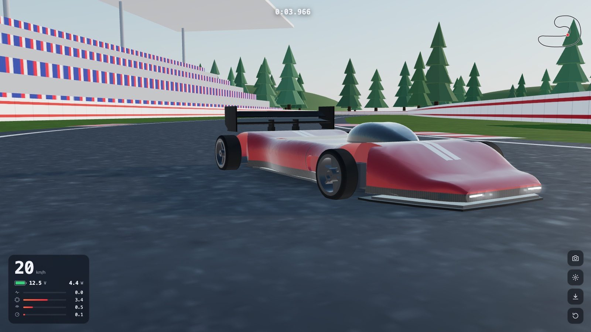
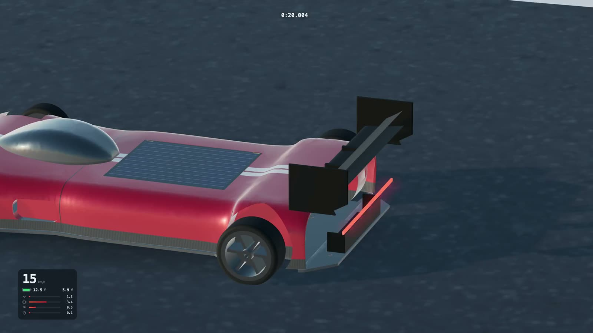
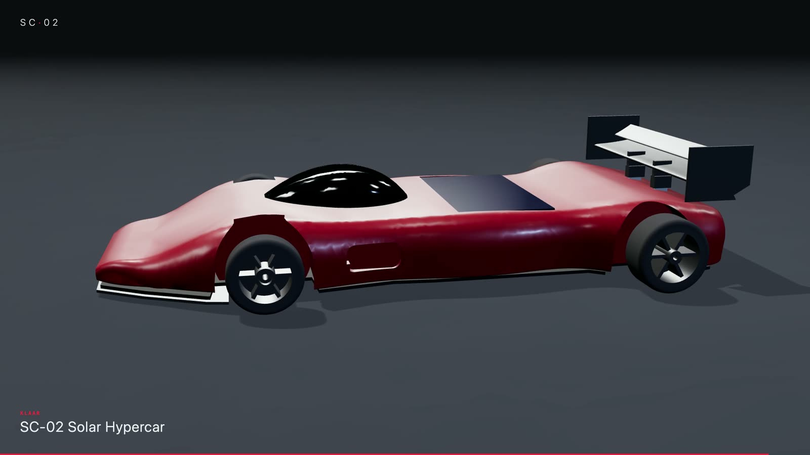
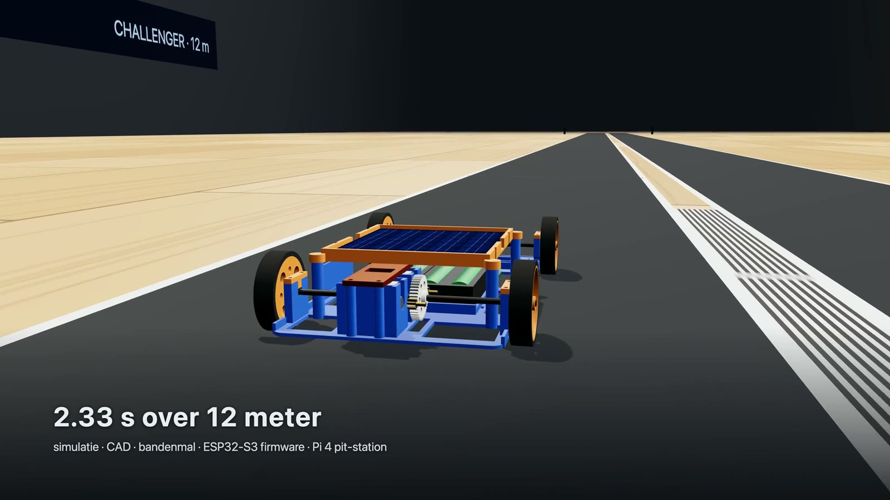
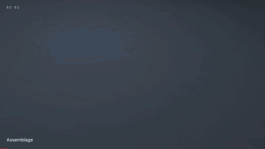
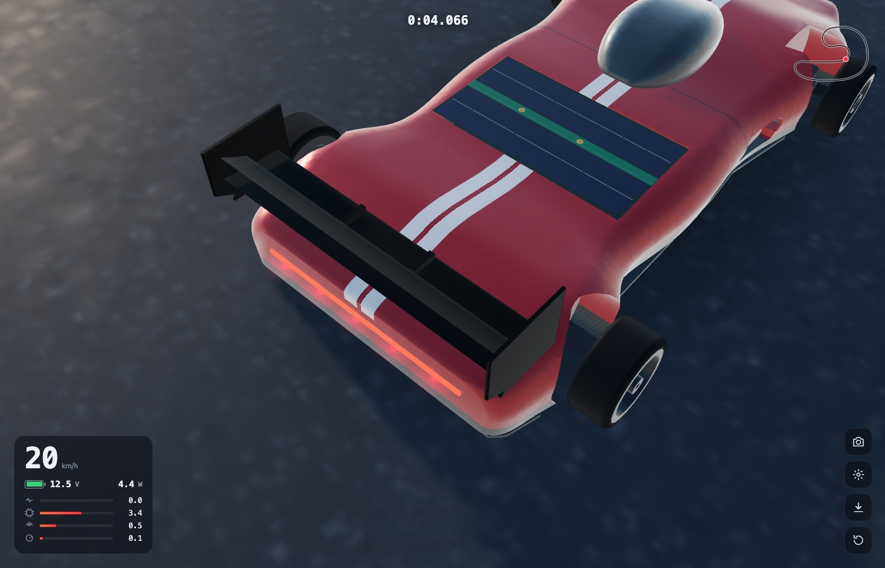
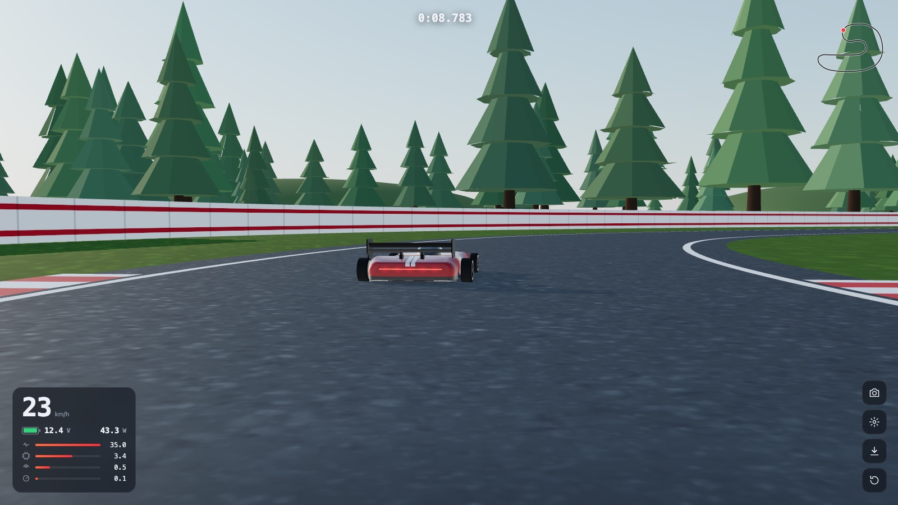
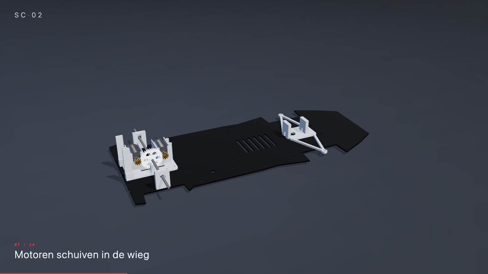
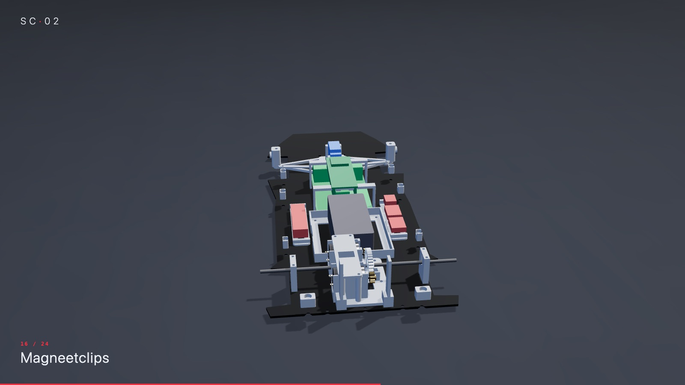
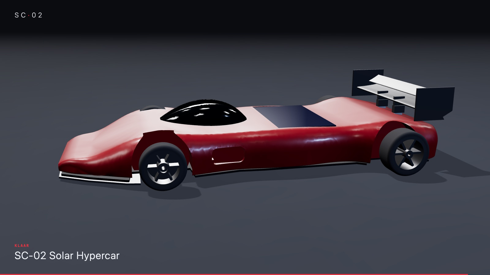

# SC-02 · Solar Hypercar



**Een gesloten Le-Mans-hypercar op zonne-energie, op schaal, voor de Solar Olympiade.**
De wagen is volledig 3D-printbaar (PLA + TPU-banden). Hij heeft een Raspberry Pi 4 en een ESP32-S3 aan boord, je bestuurt hem met een Bluetooth-controller of met je gsm, en alles is eerst in een fysica-simulatie getest voordat er één gram plastic geprint werd.

### ▶ [Website met films en beelden](https://kvr-ciber.github.io/sc02-solar-hypercar/) · 🏎 [Rij zelf in de simulatie](https://kvr-ciber.github.io/sc02-solar-hypercar/sim/) · 🔧 [3D-assemblage](https://kvr-ciber.github.io/sc02-solar-hypercar/sim/build.html)

| [](video/sc02_rijden_1080p.mp4) | [](video/sc02_assemblage_1080p.mp4) | [](video/solar_challenger_1080p.mp4) |
|:---:|:---:|:---:|
| ▶ Rondje op het circuit | ▶ Assemblage | ▶ SC-01 Challenger |



## Specificaties

| | |
|---|---|
| Gewicht | ± 715 g (met 3S LiPo en Pi 4) |
| Batterij | 3S LiPo 1300 mAh (11,1 V) |
| Elektronica | Raspberry Pi 4 (brug naar controller/gsm) + ESP32-S3 (realtime aansturing) |
| Motordrivers | 2× DRV8871 (vooruit, achteruit, remmen) |
| Motoren | 2× Tamiya Hyper-Dash / Mach-Dash, of goedkope 130-motoren |
| Overbrenging | tandwielen module 0,8, 10:35. Printbaar, of CNC-gefreesd in POM |
| Zonnepaneel | 1 W, 110 × 60 mm, dwars op het dek |
| Banden | geprint in TPU 95A, klikken op de velg zoals een fietsband |
| Topsnelheid (simulatie) | ± 45 km/h met de Tamiya-motoren |

<p>
  
  
</p>

## Wat zit waar

| Map | Inhoud |
|---|---|
| [`f1/cad/`](f1/cad/) | Parametrische CadQuery-CAD: `p.py` (alle maten), `body.py` (carrosserie), `car.py` (alle onderdelen), `gears.py` (tandwielen), `build.py` (STL, STEP, DXF, GLB + controles) |
| [`f1/firmware/sc02/`](f1/firmware/sc02/) | ESP32-S3-firmware: motoren, stuurservo, tractiecontrole, failsafe, launch |
| [`f1/pi/`](f1/pi/) | Raspberry Pi 4: Bluetooth-controller + gsm-besturing via hotspot (`sc02_pi.py`, `phone.html`, systemd-service) |
| [`f1/web/`](f1/web/) | De 3D-simulatie in de browser (three.js) |
| [`PRINTEN_PLA_TPU/`](PRINTEN_PLA_TPU/) | **Alles printklaar**, al in de juiste printstand, met instructies |
| [`site/`](site/) | De projectwebsite (GitHub Pages), samengesteld door `site/build_site.sh` |
| [`video/`](video/) | Films in 1080p |
| [`docs/`](docs/) | Bedrading, stuklijst, ontwerpverslag, motormetingen, en het [README van de eerste versie (SC-01)](docs/SC-01_README.md) |
| `sim/`, `cad/`, `firmware/`, `pit/` | De eerste wagen SC-01 (Challenger-klasse) |

## Printen

Alles in **PLA**, alleen de **banden in TPU 95A**. Elk bestand staat al in de juiste printstand, en het getal vooraan de bestandsnaam (`2x_…`) zegt hoeveel je er nodig hebt.
De volledige instellingen per onderdeel staan in [`PRINTEN_PLA_TPU/LEESMIJ.md`](PRINTEN_PLA_TPU/LEESMIJ.md).

Kort:
- Carrosserie: 0,2 mm, tree supports, 3 wanden, 12 % infill.
- Velgen en tandwielen: 0,12 mm, 3 wanden, 25 % infill.
- Motorwieg en motorklem: liever 100 % infill, want de motoren worden warm.
- Banden: TPU, langzaam (± 25 mm/s), geen supports.

## Simulatie

Online speelbaar op **https://kvr-ciber.github.io/sc02-solar-hypercar/sim/** (WASD of pijltjes, spatie = rem, C = camera, R = reset, gamepad werkt ook). In de instellingen kies je tussen het **circuit** en een **oneindige rechte lijn** met afstandsteller en 12 m-sprinttimer. Met de knop **direct / BT · 35 ms / gsm · 120 ms** voel je de vertraging (met schommeling) die je zou hebben als je de echte wagen via de Pi bestuurt: Bluetooth-controller → Pi 4 → UART → ESP32, of gsm via de hotspot. Dat zijn schattingen, nog niet gemeten op de echte wagen.

Lokaal draaien:

```bash
cd f1/web
python3 -m http.server 8000
# open http://localhost:8000
```

## Hoe we het gemaakt hebben

1. **Reglement eerst.** We begonnen met het reglement van de Solar Olympiade: maximale breedte, verplicht zonnepaneel met diode, batterijregels. Elke ontwerpkeuze moest daar binnen passen.

2. **Fysica-simulatie (SC-01).** Voor de eerste wagen schreven we een race-simulatie met batterij, motor, bandslip en launch control. Daarmee kozen we motor, overbrenging en wielmaat. Resultaat: **2,33 s over 12 m** vanuit stilstand. Zie [docs/SC-01_README.md](docs/SC-01_README.md).

3. **Parametrische CAD.** Het hele model is code (CadQuery). Eén maat aanpassen in `p.py`, `build.py` draaien, en alle STL-, STEP- en DXF-bestanden worden opnieuw gemaakt.

4. **"Te speelgoed."** De eerste versie werkte, maar zag eruit als speelgoed: open wielen, zichtbare draden en schroeven. Dat was de belangrijkste feedback.

5. **SC-02: gesloten Le-Mans-hypercar.** Daarom een volledig nieuw ontwerp: wielen in wielkasten, een gesloten carrosserie, een koepel, achtervleugel, splitter en diffuser. Van buiten zie je niets van de techniek.

6. **CAD-problemen opgelost.** Een paar die we onderweg tegenkwamen:
   - **OCC-booleans faalden stil.** Ze gaven een leeg of kapot resultaat zonder foutmelding. Oplossing: de booleans laten doen door `manifold3d`, dat altijd een waterdicht resultaat geeft.
   - **De loft vouwde de staart en de neus terug.** De carrosserie klapte op zichzelf. Oplossing: rechtstreeks OCC `ThruSections` aanroepen, met volledige controle over de doorsneden.
   - **Zwevende magneetbosjes.** De houders voor de magneten van de carrosserie hingen in de lucht, los van de wand. Ze zijn nu verbonden met de structuur.
   - **Botsende onderdelen.** Een volledige botsingscontrole test elk onderdeel tegen elk ander (nu: 0 botsingen). Zo vonden we o.a. een diffuser in de vloer, splitter-vinnen door de vloer, een koepel door het dek, een te korte batterijbak en ESP-pinnen door de Pi-USB.
   - **Twee echte ontwerpfouten.** De carrosserie zat vast op de achteras (gesloten wielkasten): nu zijn de asgleuf en wielkasten onderaan open en tilt de body er gewoon af. En de motoren konden niet in het tandwiel zakken: nu schuiven ze langs hun as van achteren in de wieg.

7. **Firmware en Pi-brug.** De ESP32-S3 doet het realtime werk: tractiecontrole, een failsafe die stopt als het signaal wegvalt, en een launch-modus. De Pi 4 is de brug: hij leest een Bluetooth-controller in, en via een hotspot kun je ook met je gsm sturen.

8. **three.js-simulatie.** Een 3D-simulatie in de browser met een fietsmodel voor het sturen, Pacejka-banden voor de grip, en het verbruik per onderdeel (Pi, ESP, servo, motoren), live tijdens het rijden.

9. **Printplaten en STEP-bestanden.** Alle onderdelen zijn verdeeld over printplaten, in de juiste printstand, en ook beschikbaar als STEP om verder te bewerken in Fusion, FreeCAD of Onshape.

10. **Budget.** We vergeleken AliExpress met Europese leveranciers, inclusief de EU-invoerheffing op kleine pakketjes. Goedkoop bestellen is niet altijd goedkoper.

11. **Assemblage-animatie.** 24 stappen, en elke montagebeweging is nagerekend tegen de CAD (40 punten per baan): geen enkel onderdeel gaat door een ander. Ook [interactief in 3D](https://kvr-ciber.github.io/sc02-solar-hypercar/sim/build.html).

<p>
  
  
  
</p>

## Gemaakt met Claude Code

Dit project is gebouwd door Kobe samen met [Claude Code](https://claude.com/claude-code), de AI-programmeerassistent van Anthropic. Claude schreef een groot deel van de simulatie, de CAD-code en de firmware. De ideeën, de keuzes, de feedback en het testen kwamen van Kobe.

## Niet in deze repo

- Het reglement van de Solar Olympiade (auteursrecht van de organisatie).
- Wachtwoorden: kopieer `firmware/solar_car/secrets.example.h` naar `secrets.h` en vul je eigen hotspotgegevens in.
- 4K-video's (te groot voor GitHub; de 1080p-versies staan erin).
