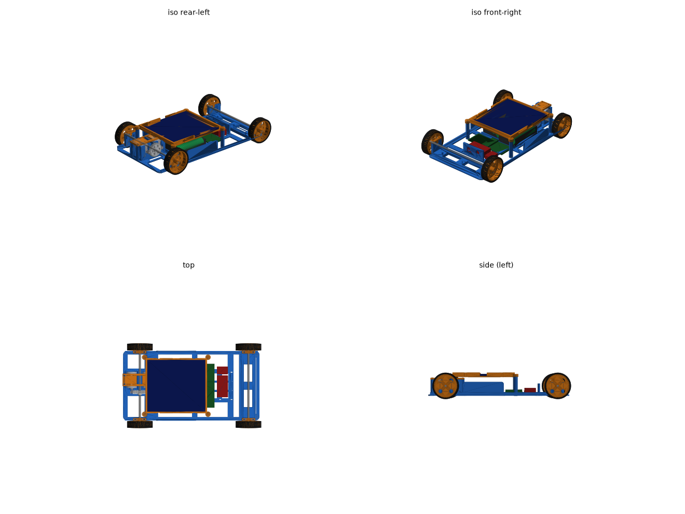
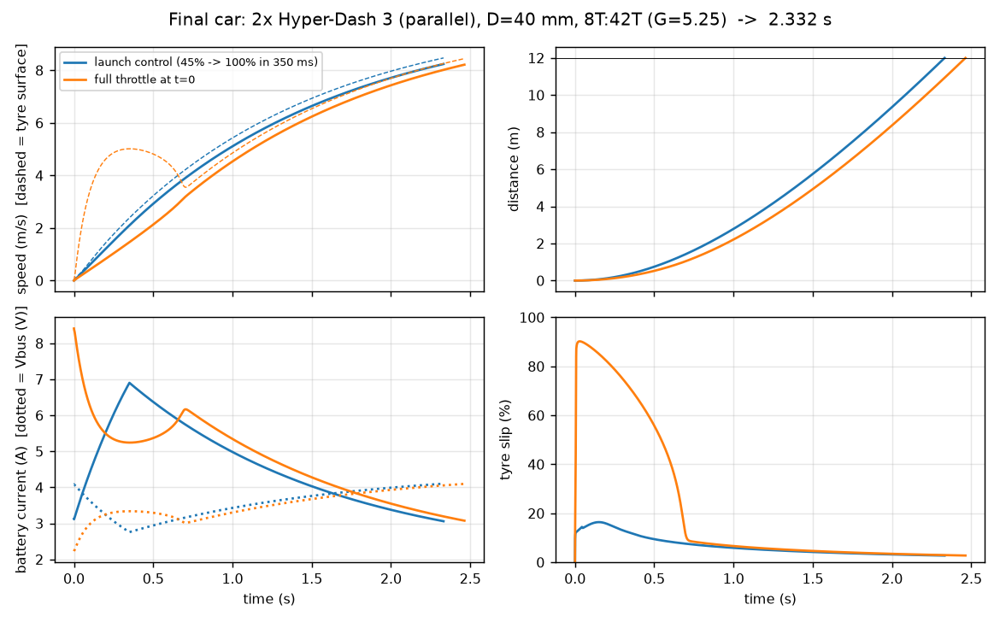

# Solar Olympiade 2027 – Challenger car


A complete, simulated, 3D-printable solar car for the **Challenger class** (fastest over 12 m from standstill, max 30 cm wide).

| | |
|---|---|
| **Predicted time over 12 m** | **2.33 s** (launch control on), 2.46 s at full throttle from the start |
| Speed at the finish | 8.2 m/s (≈ 30 km/h) |
| Mass | 310 g (CAD + bought parts), 64.7 % on the driven rear axle |
| Size | 215 × 131 mm (rule: width ≤ 300 mm) |
| Drive | 2× Tamiya Hyper-Dash 3 (130 size) in parallel → 8T:42T (5.25:1) → rear axle |
| Wheels | Ø40 mm, cast silicone tyres on printed rims (TPU tyres as a cheaper option) |
| Brains | ESP32-S3: launch control, odometry, safety stop, 500 Hz logging |
| Pit | Raspberry Pi 4: timing gate, Wi-Fi start, run log + comparison with the simulation |
| Cost | about €70 total, about €38 in the budget version (see [docs/BOM.md](../docs/BOM.md)) |



## Folder map

| Folder | What is inside |
|---|---|
| `sim/` | Race simulation (battery, motor, tyre slip, launch control). `sim.py` optimises motor, gearing, wheel size; `plots.py` makes all figures; `sensitivity.py` covers the what-ifs. |
| `cad/` | Parametric CadQuery model. Change `params.py`, then run `build.py` and every STL/STEP is regenerated. `check.py` tests every part pair for collisions, `mold_check.py` checks the tyre mold, `render.py` draws the pictures. |
| `cad/out/stl/` | All printable parts, already in print orientation |
| `cad/out/print/` | **Ready-to-print Bambu Studio projects** (P1S, 0.4 nozzle), plus `print_report.json` with grams and print times |
| `cad/out/step/` | STEP files + `assembly.step` (open in Fusion/FreeCAD/Onshape) |
| `firmware/solar_car/` | ESP32-S3 firmware (Arduino core 3.3, compiles) |
| `pit/` | Raspberry Pi 4 pit/timing station (Flask web app) |
| `docs/` | Bill of materials, build guide, wiring, design-report draft, motor measurement |

## Quick start

```bash
# simulation
.venv/bin/python sim/sim.py && .venv/bin/python sim/plots.py
# CAD (after editing cad/params.py)
cd cad && ../.venv/bin/python build.py && ../.venv/bin/python check.py && ../.venv/bin/python render.py
# re-slice for the P1S
../.venv/bin/python slicer/flatten.py && ../.venv/bin/python slicer/slice_all.py
# firmware
arduino-cli compile -b esp32:esp32:esp32s3:CDCOnBoot=cdc firmware/solar_car
arduino-cli upload  -b esp32:esp32:esp32s3:CDCOnBoot=cdc -p /dev/cu.usbmodem* firmware/solar_car
# pit station test on the Mac (fake car)
python3 pit/pit.py --mock      # then open http://localhost:8080
```

## Key decisions (short version, details in [docs/design_report.md](../docs/design_report.md))

1. **The battery does the racing; the panel is mandatory but tiny.** The kit panel gives 0.88 W. The 4×AA NiMH pack delivers about 20 W for 2 s. The panel sits in a frame that doesn't modify it (rule 4.5) and connects through the mandatory diode (rule 4.3).
2. **Two small motors beat one big one in practice.** One RS-380 is 0.06 s faster on paper. It's also 70 g heavier, needs pinions that are hard to source, and loses badly on a slippery floor. Two 130-size motors on one spur gear are light and cheap and use standard Mini 4WD parts. If one motor dies, the car still finishes (2.48 s).
3. **Grip is the biggest lever.** Going from μ 0.6 to 1.1 changes the time by 0.6 s, more than any motor choice. Hence soft cast silicone tyres, 65 % of the weight on the driven axle, and launch control (spin drops from 90 % slip to 15 %, saving 0.13 s).
4. **The Pi 4 stays off the car.** On board it would cost 0.21 s (60 g + 3–4 W). As the timing station it helps you get faster: measure runs, tune launch control, compare with the simulation.



## What you still need to check with the real parts

- **Measure the kit battery holders** and panel thickness, then update `BATT_HOLDER` / `PANEL_T` in `cad/params.py`.
- **Print one rim and one bearing cap first** to tune `PRESS_BORE` and `BRG_FIT` for your printer and filament.
- **Measure your motors** ([docs/motor_measurement.md](../docs/motor_measurement.md)). The motor values in the simulation are estimates.
- Ask the organisers (SolarOlympiade@solarteam.be) whether a **Wi-Fi start is allowed** during the race. Race mode needs no radio, so there's no risk.
