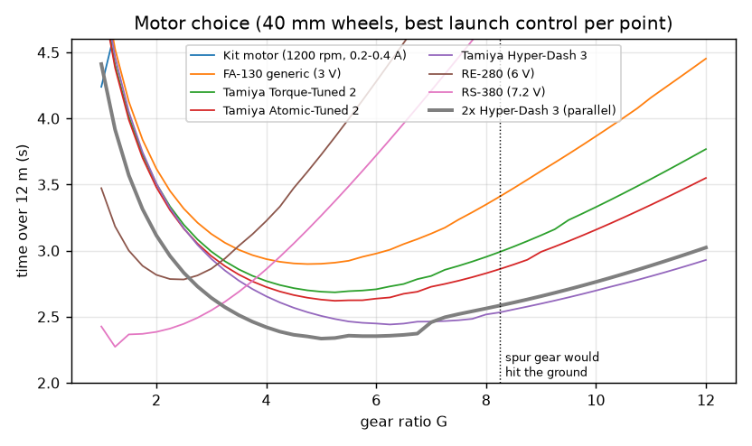
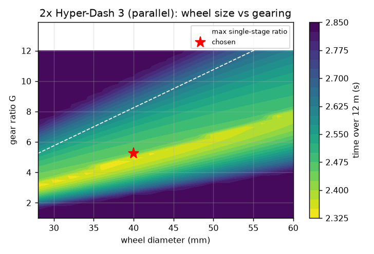
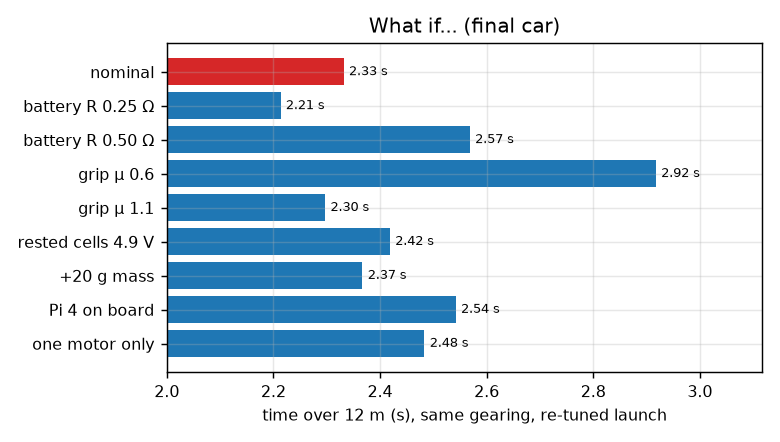
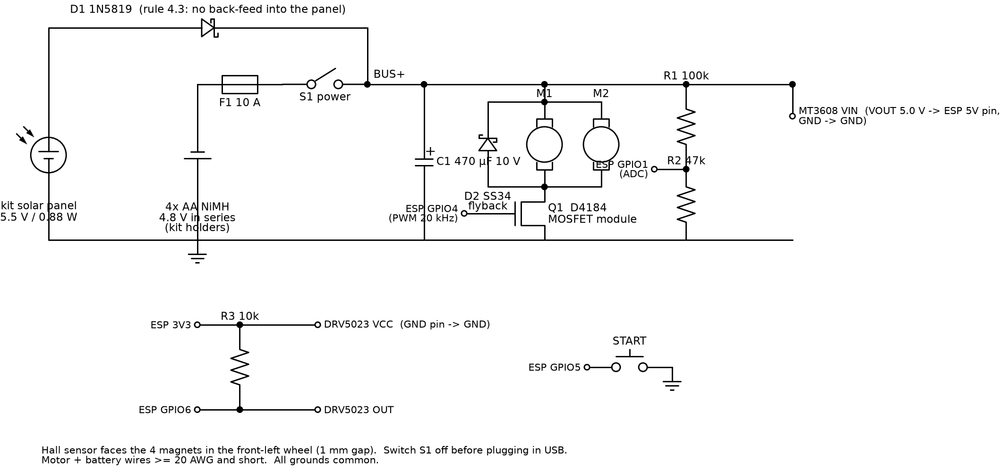

# Design report – Challenger class (draft)

*Solar Olympiade 2027, 23rd edition. Draft in English; translate into Dutch for submission if required.*

## 1. Goal and constraints

Cover **12 m in a straight line from standstill as fast as possible** (rule 2.1), with:
- width ≤ 30 cm (2.2); steering optional (2.3)
- the kit **solar panel** (5.5 V, 0.16 A, 0.88 W, 90 × 80 mm), used and connected through a diode, not modified (4.1–4.5)
- the kit **4× AA NiMH** (1.2 V, 2000 mAh) in series, in holders, no other energy storage (5.1–5.6); fuse recommended (5.7)
- any DC motor(s) (6.1), no converted RC car (1.4)
- budget: refund up to €50 (1.5), Budget prize for low cost

## 2. Where does the energy come from?

| Source | Power | Energy used in one run |
|---|---|---|
| Kit panel (full sun) | 0.88 W | 2 J in 2.3 s |
| 4× AA NiMH | up to ~20 W into the motors | ~ 40 J (3 mAh of 2000 mAh) |

The run is a **2.3 s sprint**, so the battery pack's **power** (voltage under load) decides the race. Its energy hardly matters: one run uses 0.15 % of the pack. The panel is wired as the rules require and tops up the pack between runs.

## 3. Method: simulate first, then build

We wrote a time-step simulation (`sim/sim.py`, 0.1 ms steps) of the whole car:

- **Battery**: open-circuit voltage 5.2 V, internal resistance 0.35 Ω (cells + holders + switch + fuse + wires)
- **DC motor**: back-EMF constant ke, winding resistance R, no-load current I0, rotor inertia
- **PWM launch control**: duty cycle ramps from *d0* to 100 % in *Tr* ms
- **Tyres**: slip curve (grip rises with slip up to 15–20 %, then falls when the wheel spins); μ = 0.9 for silicone on a hall floor
- **Car**: mass, rolling resistance (Crr 0.015), bearing drag, air drag (CdA 0.003 m²), wheel and gear inertia, weight transfer to the rear axle while accelerating

For each motor, the program tries **every combination** of gear ratio (1–14), wheel diameter (28–70 mm) and launch setting, about 6 000 cars per motor, and keeps the fastest buildable one. "Buildable" means the spur gear must not touch the ground.

| Motor (40 mm wheels) | Best ratio | Time 12 m |
|---|---|---|
| Kit motor (1200 rpm) | 1.0 | 4.24 s |
| Generic FA-130 | 4.75 | 2.90 s |
| Tamiya Torque-Tuned 2 | 5.25 | 2.69 s |
| Tamiya Atomic-Tuned 2 | 5.25 | 2.62 s |
| Tamiya Hyper-Dash 3 | 6.25 | 2.44 s |
| RS-380 (7.2 V) | 1.25 | 2.27 s |
| **2× Hyper-Dash 3 in parallel** | **5.0–5.25** | **2.33 s** |

**Choice: 2× Hyper-Dash 3.** One RS-380 is 0.06 s faster on paper, but it is 70 g heavier, its pinions (2.3 mm shaft) are hard to buy, and on a slippery floor (μ 0.6) it is the slowest of the three. The two small motors share one spur gear, use standard Mini 4WD pinions, and still finish in 2.48 s if one fails.

## 4. Gearing and wheels

The map shows that wheel size and ratio trade off against each other (what matters is speed per motor revolution). We chose **Ø40 mm wheels** (rolls over floor joints, light, room for a hall sensor) and **8T : 42T, module 0.5 → 5.25:1**. The 42T spur gear (Ø22 mm) leaves 9 mm ground clearance.

## 5. Grip, weight distribution and launch control

The what-if study shows **grip is the biggest lever** (μ 0.6 → 1.1 = 0.6 s). Our answers:
1. **Soft silicone tyres** cast in our own 3D-printed 4-cavity mold, directly onto the rims (dovetail rib + 12 keys, so the tyre cannot slip)
2. **64.7 % of the weight on the driven rear axle** (motors over the axle, batteries just in front of it)
3. **Launch control**: full power at t = 0 makes the tyres spin (90 % slip). Starting at 45 % duty and ramping to 100 % in 350 ms keeps slip near the grip peak and saves 0.13 s.

## 6. Construction

- Fully **parametric CAD** (CadQuery/Python): one parameter file, every part regenerates. An automatic collision check runs on all part pairs.
- **ASA chassis** (lighter than PLA, heat resistant), **PLA rims and gear** (stiff and accurate), all printed **without supports** on a Bambu P1S.
- **Ball bearings** (683ZZ) on both axles; axles are 3 mm carbon rods (1.5 g each instead of 8 g steel).
- **Front axle carrier pivots** on a centre screw with two slots, to trim the car to run dead straight (no steering needed on 12 m).
- Panel in a clip-in frame: **not modified** (rule 4.5).
- Team sticker walls on both sides.

| Mass budget | g |
|---|---|
| Batteries + holders (kit) | 124 |
| Solar panel (kit) | 25 |
| 2 motors | 38 |
| Printed parts (chassis, carrier, frame, clamp, caps, gear) | 57 |
| 4 wheels (rim + silicone) | 27 |
| Electronics + wiring | 33 |
| Axles, bearings, screws | 6 |
| **Total** | **310** |

## 7. Electronics and software

- Panel → **Schottky diode 1N5819** → bus (rule 4.3), **10 A fuse** (rule 5.7) and a main switch.
- **Low-side MOSFET** (D4184, 10 mΩ), driven at 20 kHz by an **ESP32-S3**, flyback diode SS34.
- The ESP is powered by a 5 V boost converter, so it keeps working when the pack sags to 2.7 V during the launch.
- **Hall sensor + 4 magnets** in a front wheel: distance, speed, our own 12 m time, automatic stop after 14 m, stall protection.
- 500 Hz data logging. In test mode the car joins the Wi-Fi of our **Raspberry Pi 4 pit station** (light gate at 12 m, start button, graphs of every run against the simulation). In race mode Wi-Fi is off and the car starts with its own button.
- Why the Pi 4 is **not** on the car: the simulation shows +60 g and 3–4 W of extra load cost 0.21 s.

## 8. Testing plan

1. Measure motors and battery resistance → update the simulation (docs/motor_measurement.md)
2. Calibrate the odometry, then trim straight-line running
3. Tune launch control on the pit station: vary start duty and ramp, keep the fastest, compare with the simulation
4. Compare measured and simulated speed curves → improve the model (grip, rolling resistance)

## 9. Cost

About **€70** for the full version (two Tamiya motors, silicone tyres, timing gate). The budget version (generic motors, TPU tyres, about €38) stays under the €50 refund. Details are in docs/BOM.md.

## 10. Rule compliance

| Rule | ✔ |
|---|---|
| 1.4 no converted RC car; own design | ✔ |
| 1.6 / 4.1 kit panel + 4 kit cells used | ✔ |
| 2.2 width ≤ 300 mm | ✔ 131 mm |
| 4.3 diode panel → bus | ✔ 1N5819 |
| 4.5 panel not modified | ✔ clip-in frame |
| 5.1 no other energy storage | ✔ (only a 470 µF decoupling capacitor, can be left out) |
| 5.5 cells not soldered, in holders | ✔ |
| 5.6 cells in series | ✔ |
| 5.7 fuse | ✔ 10 A |
| sticker left + right | ✔ sticker walls |
